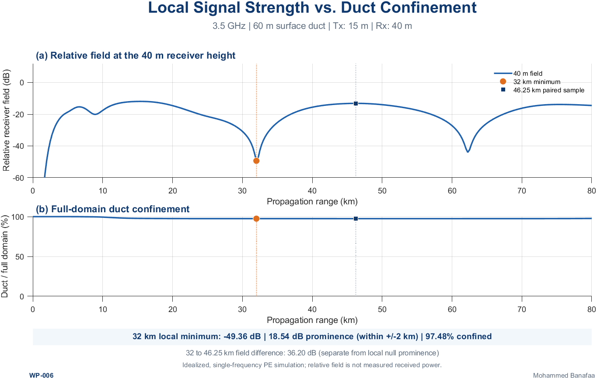
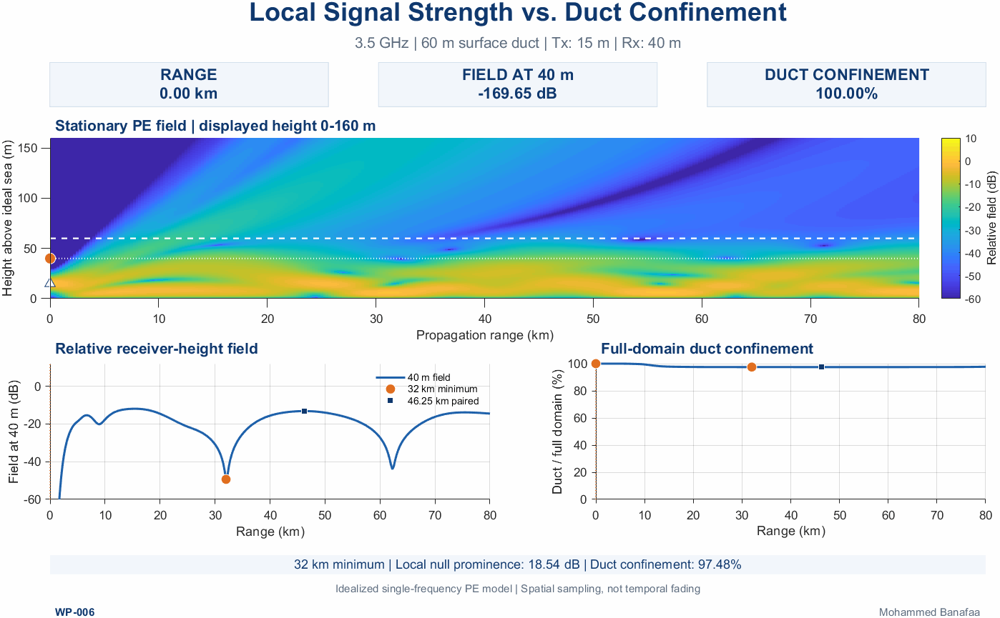

# [WP-006] A Deep Fade Does Not Mean the Duct Vanished
## Local Signal Strength vs. Duct Confinement

**Wireless Propagation Visuals (WP)**  
**Author:** Mohammed Banafaa

---

## Overview

In [WP-005], we examined how different operating frequencies produce different spatial electromagnetic-field patterns within the same atmospheric duct. The resulting field maps revealed local maxima and minima along the propagation path.

WP-006 investigates the next question:

> **Does a deep local field minimum at a receiver mean the propagating field is no longer confined within the duct?**

Not necessarily. A receiver samples the electromagnetic field at a particular range and height. Duct confinement, by contrast, characterizes how the *modeled field intensity is distributed vertically*. These quantities can behave differently even when the atmospheric profile is fixed.

This example uses a **single-frequency, two-dimensional Parabolic Equation (PE) simulation** to compare the field sampled at a receiver height with the fraction of vertically integrated modeled field intensity within a surface-based atmospheric duct.

---

## Scientific Principle

Let \(u(r,z)\) denote the complex PE field at range \(r\) and height \(z\). The relative receiver-height field level is

\[
L_{\mathrm{Rx}}(r)=20\log_{10}\left(\frac{|u(r,h_{\mathrm{Rx}})|}{A_{\mathrm{ref}}}\right)\ \mathrm{dB},
\]

where \(A_{\mathrm{ref}}\) is a fixed normalization amplitude. This is a **relative field quantity**, not calibrated received power.

The full-domain duct confinement metric is

\[
\eta_{\mathrm{duct}}(r)=
\frac{\displaystyle\int_{0}^{h_{\mathrm{duct}}}|u(r,z)|^2\,\mathrm{d}z}
{\displaystyle\int_{0}^{z_{\mathrm{max}}}|u(r,z)|^2\,\mathrm{d}z}
\times100\%.
\]

Here, the numerator integrates modeled field intensity within the surface duct, while the denominator integrates across the **full computational height**. This normalized PE intensity fraction must not be interpreted as a measured fraction of transmitted power or a calibrated three-dimensional energy flux. It also depends on the modeled domain and its absorbing boundary.

The key distinction is that a small value of \(|u(r,h_{\mathrm{Rx}})|\) at one height does **not** establish that \(\eta_{\mathrm{duct}}(r)\) is small.

---

## Simulation Scenario

The reference case is an *idealized* coastal propagation setting at a frequency relevant to contemporary mid-band terrestrial wireless systems. It does not use a measured atmospheric profile or a calibrated commercial base-station antenna pattern.

| Parameter | Reference value |
|---|---|
| Carrier frequency | **3.5 GHz** |
| Atmospheric structure | Idealized, range-independent surface-based duct |
| Duct thickness | **60 m** |
| Modified-refractivity deficit | **20 M-units** |
| Transmitter height | **15 m** above the modeled sea |
| Receiver height | **40 m** above the modeled sea |
| Propagation range | **0–80 km** |
| Propagation method | One-way, narrow-angle, split-step PE |
| Lower surface | Smooth, perfectly conducting boundary approximation |
| Transmitter excitation | Idealized Gaussian source (not a measured antenna pattern) |
| Evaluated behavior | Spatial field variation in a stationary atmospheric profile |

The simulated field is computed over a taller vertical computational domain than the cropped height shown in the animation. **The confinement calculation uses the full numerical domain, not the cropped field-map display.**

---

## Main Numerical Observation

In the locally executed MATLAB study, the selected receiver-height field exhibits a pronounced minimum at approximately **32.00 km**:

| Quantity | Reported MATLAB result |
|---|---:|
| Receiver-field level at 32.00 km | **−49.36 dB**, relative to the stated common reference |
| Local minimum prominence within a ±2 km neighborhood | **18.54 dB** |
| Full-domain duct confinement at 32.00 km | **97.48%** |

The **18.54 dB local dip** is a neighborhood-based measure around the 32 km minimum. It should not be confused with a larger contrast obtained by comparing two widely separated ranges.

The modeled field can therefore be very weak at the receiver's particular altitude while the vertical intensity integral remains concentrated inside the duct. This result illustrates the difference between **local field sampling** and **overall modeled duct confinement**; it does not establish a real-world link fade, measured received power, or a specific modal cancellation mechanism.

---

## Folder Contents

The public WP-006 folder is organized as follows:

```text
WP-006/
├── WP006.m
├── README.md
└── Figures/
    ├── WP006_Fig_1.png
    └── WP006_Fig_2.gif
```

- **`WP006.m`** — MATLAB R2024b implementation for regenerating the PE propagation result, extracting receiver-height field and confinement metrics, and exporting the final visuals. The published version is expected to regenerate its numerical inputs without relying on private development-stage files.
- **`README.md`** — The scientific motivation, model assumptions, numerical interpretation, reproducibility instructions, and published post text.
- **`Figures/WP006_Fig_1.png`** — Static comparison of receiver-height relative PE field and vertically integrated duct confinement versus range.
- **`Figures/WP006_Fig_2.gif`** — Animation combining a stationary PE field map with synchronized spatial-sampling and confinement readouts. The scanning marker denotes *range*, not elapsed time.

### Static visualization



### Animated visualization



---

## MATLAB Reproduction

1. Open the repository's `WP-006` folder in **MATLAB R2024b**.
2. Run the script from the MATLAB Command Window:

   ```matlab
   WP006
   ```

3. The repository version of `WP006.m` generates the PE numerical inputs and export figures to the local `Figures` directory without requesting an output folder or private development-stage `.mat` files.
4. Compare the regenerated figure's selected 32 km field minimum, its neighborhood prominence, and the computed confinement percentage with the values reported above. Small numerical differences may depend on numerical settings or software environment; material differences require investigation rather than silent adjustment of annotations.

**Reproducibility:** The release script must include the validated calculation path (or package all indispensable inputs within this public folder). A plotting-only script requiring unpublished intermediate files would not reproduce this example. Consult the script header for toolbox requirements and expected runtime.

---

## Physical Interpretation and Limitations

- The atmosphere and propagation geometry are fixed. The animation scans **spatial position** and does not model temporal fading or changes in duct occurrence.
- The source, sea-surface boundary, and atmospheric profile are idealizations. They do not represent a measured coastal channel or a standardized 5G NR antenna pattern.
- The relative PE field in dB is **not** measured received signal power, and the calculation does not include a complete link budget, noise, throughput, or reliability model.
- The reported confinement fraction is a **modeled vertical intensity ratio**. Absorption at the numerical upper boundary and the computational domain must be considered when interpreting it.
- A local minimum is compatible with coherent interference and vertical field structure; attributing it to particular propagation modes would require additional modal analysis.

**Practical takeaway:** A deep minimum observed at one receiver height is insufficient evidence, by itself, that the atmospheric duct has stopped confining the modeled field.

---

## References

1. Ö. Özgün *et al.*, “PETOOL: MATLAB-based one-way and two-way split-step parabolic equation tool for radiowave propagation over variable terrain,” *Computer Physics Communications*, 2011. https://doi.org/10.1016/j.cpc.2011.07.017
2. M. Levy, *Parabolic Equation Methods for Electromagnetic Wave Propagation*, IEE Electromagnetic Waves Series 45, 2000.
3. F. Liu *et al.*, “Atmospheric Ducting Effect in Wireless Communications: Challenges and Opportunities,” *Journal of Communications and Information Networks*, vol. 6, no. 2, 2021.

---

## LinkedIn Post

### [𝐖𝐏-𝟎𝟎𝟔] 𝐀 𝐃𝐞𝐞𝐩 𝐅𝐚𝐝𝐞 𝐃𝐨𝐞𝐬 𝐍𝐨𝐭 𝐌𝐞𝐚𝐧 𝐭𝐡𝐞 𝐃𝐮𝐜𝐭 𝐕𝐚𝐧𝐢𝐬𝐡𝐞𝐝: 𝐋𝐨𝐜𝐚𝐥 𝐒𝐢𝐠𝐧𝐚𝐥 𝐒𝐭𝐫𝐞𝐧𝐠𝐭𝐡 𝐯𝐬. 𝐃𝐮𝐜𝐭 𝐂𝐨𝐧𝐟𝐢𝐧𝐞𝐦𝐞𝐧𝐭

📡 In WP-005, we explored how operating frequency changes the spatial electromagnetic field pattern within the same atmospheric duct, producing peaks and deep minima. But does a weak field at the receiver mean the duct is no longer guiding the wave?

🌊 Not necessarily. A local field minimum can occur even when most of the modeled electromagnetic field intensity remains concentrated within the duct.

📐 Using the **Parabolic Equation (PE)** method, we simulate 3.5 GHz propagation through an idealized 60 m surface-based duct. At **32 km**, the receiver-height field exhibits an **18.54 dB local dip** (evaluated within ±2 km), while approximately **97.48% of the vertically integrated modeled field intensity** remains confined within the duct.

🧠 **The practical implication:** A weak local received field does not necessarily indicate loss of duct confinement. This distinction matters when interpreting spatial signal variations in long-range coastal communication and interference scenarios.

🎥 **The accompanying PE animation** tracks the receiver-height field and duct confinement along the propagation path, illustrating how a pronounced local minimum can coexist with persistent confinement under fixed atmospheric conditions.

↻ **Next up:** How does atmospheric ducting change the received field compared with a standard atmosphere?

#TroposphericDucting #RadioPropagation #ParabolicEquation #WirelessCommunications

**Reference:** Ö. Özgün et al., “PETOOL: MATLAB-based one-way and two-way split-step parabolic equation tool for radiowave propagation over variable terrain,” *Computer Physics Communications*, 2011. https://doi.org/10.1016/j.cpc.2011.07.017

*Simulation note: Results represent an idealized, single-frequency PE model rather than measured received power or temporal fading.*
