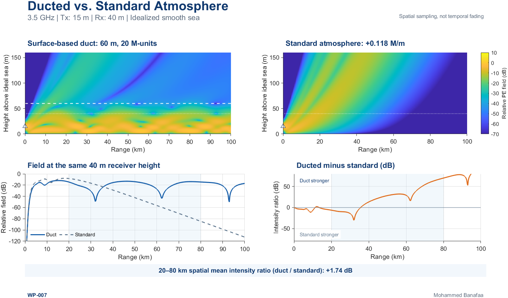
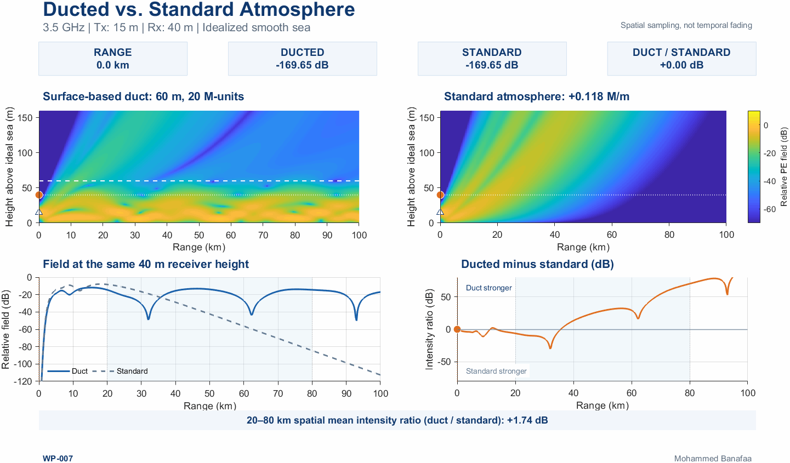

# [WP-007] When Does an Atmospheric Duct Actually Strengthen the Received Field?

**Wireless Propagation Visuals (WP)**  
**Author:** Mohammed Banafaa  
**Application context:** 3.5 GHz coastal terrestrial propagation (5G NR n78 frequency band)

---

## Overview

In [WP-006], we showed that a pronounced receiver-height field minimum can occur while most of the modeled electromagnetic field intensity remains confined within an atmospheric duct. That result highlights the distinction between a *local field sample* and the *vertical distribution of the propagated field*.

WP-007 asks the next question:

> **Compared with a standard, nonducting atmosphere, does the presence of an atmospheric duct actually strengthen the field at a particular receiver?**

The answer depends on propagation range and receiver position. To isolate the atmospheric contribution, this example uses the **Parabolic Equation (PE)** method to compare two propagation environments with identical source, frequency, antenna geometry, lower boundary, numerical settings, and field normalization. **Only the modified-refractivity profile changes.**

This is a controlled *relative-field* comparison, not a calibrated 5G link budget or an estimate of operational coverage range.

---

## Scientific Principle

Let \(u_{\mathrm{duct}}(r,z)\) and \(u_{\mathrm{std}}(r,z)\) denote the complex, two-dimensional PE fields at range \(r\) and altitude \(z\), for the ducted and standard atmospheres. At the fixed receiver height \(h_R=40\,\mathrm{m}\), the **pointwise relative intensity difference** is

\[
\Delta L(r) = 10\log_{10}\!\left(
\frac{|u_{\mathrm{duct}}(r,h_R)|^2}
{|u_{\mathrm{std}}(r,h_R)|^2}
\right)\quad\mathrm{dB}.
\]

- **\(\Delta L(r)>0\):** the ducted model has a stronger field at that particular receiver position.
- **\(\Delta L(r)<0\):** the standard-atmosphere model has a stronger field at that position.

Because interference creates peaks and minima, a pointwise ratio can become extremely large when its denominator is very small. It does **not** by itself establish a usable radio link.

For a more representative comparison across a specified range window \([r_1,r_2]\), the study evaluates the **ratio of spatially integrated linear intensities**:

\[
\overline{\Delta L}_{[r_1,r_2]} =
10\log_{10}\!\left(
\frac{\displaystyle\int_{r_1}^{r_2}|u_{\mathrm{duct}}(r,h_R)|^2\,\mathrm{d}r}
{\displaystyle\int_{r_1}^{r_2}|u_{\mathrm{std}}(r,h_R)|^2\,\mathrm{d}r}
\right)\quad\mathrm{dB}.
\]

**This is not the arithmetic average of the pointwise dB curve.** The metric describes the selected spatial window of this particular idealized PE model; it is not link throughput, coverage probability, or measured received power.

---

## Controlled Simulation Scenario

The carrier frequency is **3.5 GHz**, within the standardized **5G NR n78 (3.3–3.8 GHz)** band. This makes the illustration relevant to propagation and possible unintended long-distance reception in coastal terrestrial networks. It does **not** simulate an actual commercial base-station antenna or 5G network.

| Parameter | Ducted and standard-atmosphere cases |
|---|---|
| Carrier frequency | **3.5 GHz** |
| Transmitter height | **15 m** above the ideal sea |
| Receiver height | **40 m** above the ideal sea |
| Simulated propagation range | **0–100 km** |
| Statistical comparison window | **20–80 km** |
| Numerical method | One-way split-step PE (SSPE), idealized 2D scalar model |
| Source | Identical normalized Gaussian launch in both cases |
| Lower boundary | Ideal, smooth perfectly conducting sea (horizontal-polarization Dirichlet limit) |
| Range step / height step | **50 m / 0.25 m** in the baseline |
| Numerical ceiling / upper absorber onset | **2,000 m / 600 m** |
| Angular-filter cutoff | **5°** |
| Field-map display height | **0–160 m** (display crop only) |
| Common field-map color scale | **−70 to +10 dB**; values outside limits are clipped for display |

### Atmospheric profiles

Let \(z\) denote height in **metres**, \(M(z)\) modified refractivity in **M-units**, and \(M_0\) the common reference value. The idealized surface duct has a 60 m thickness and a 20 M-unit deficit:

\[
M_{\mathrm{duct}}(z)=M_0-\frac{20}{60}\min(z,60)
+0.118\max(z-60,0).
\]

The nonducting reference is

\[
M_{\mathrm{std}}(z)=M_0+0.118z.
\]

Both profiles are range independent and idealized. They are **not contemporaneous measured atmospheric soundings**. The common positive modified-refractivity gradient corresponds to **118 M-units/km**.

---

## MATLAB Findings

The locally executed MATLAB R2024b run reports:

| Metric | Result |
|---|---:|
| Simulation extent | **0–100 km** |
| Analysis window | **20–80 km** |
| Ratio of window-integrated receiver-height field intensities, duct / standard | **+1.738116 dB (≈ +1.74 dB)** |
| Sampled positions with a stronger ducted field, within the window | **73.859%** |
| Sampled positions with a stronger standard-atmosphere field | **26.141%** |

The sampled-position percentages are **spatial counts along the simulated range grid**, not probabilities of coverage, duct occurrence, or service availability. They are retained as supporting diagnostics, rather than headline publication claims.

**Principal conclusion:** In this idealized example, the ducted case has a **1.74 dB higher spatially averaged receiver-height field intensity over 20–80 km**, but it is **not stronger at every distance**. The ratio may reverse sign as the local field distributions develop different interference patterns.

### Numerical consistency

The supplied MATLAB run summary reports the change in the **+1.738116 dB** window metric under selected solver variations:

| Numerical check | Change in mean-intensity ratio |
|---|---:|
| Halve range step (50 → 25 m) | **−0.000098 dB** |
| Halve height step (0.25 → 0.125 m) | **+0.000007 dB** |
| Raise computational ceiling (2,000 → 2,400 m) | Approximately **0 dB** at reported precision |
| Move absorber onset (600 → 700 m) | Approximately **0 dB** at reported precision |

These are **internal numerical-stability tests** under the specified model, not independent validation against observations or a more complete electromagnetic model.

---

## Visualization Guide

### Main figure — Ducted versus standard atmosphere



The publication figure combines four complementary views:

1. **Ducted PE field map:** the computed spatial field distribution with the surface-based duct.
2. **Standard-atmosphere PE field map:** the same source and geometry without the duct; both maps use the **same normalization and color limits**.
3. **Receiver-height fields:** the two relative PE field levels evaluated at 40 m over 0–100 km.
4. **Ducted minus standard (dB):** the pointwise intensity ratio, distinguishing locations where one modeled atmosphere gives a stronger field than the other.

The headline annotation refers to the **20–80 km analysis window**, even though the plotted simulation extends to 100 km. Colors below **−70 dB** are clipped in the maps; high positive pointwise ratios can arise when the standard-atmosphere field is extremely weak.

### Animated visualization



The animation shows spatial sampling of **stationary, single-frequency PE solutions**. It does not represent temporal fading, changing weather, or physical time-domain wavefront motion. Normalization and color limits should remain fixed across cases and frames.

---

## Repository Contents

```text
WP-007/
├── WP007.m
├── README.md
└── Figures/
    ├── WP007_Final.png
    └── WP007_Final.gif
```

- **`WP007.m`** — public MATLAB source for generating the two SSPE solutions, extracting receiver-height metrics, forming the relative intensity comparisons, and exporting the publication figures. The final public version should regenerate its numerical inputs rather than depend on unpublished Stage B files.
- **`README.md`** — scientific objective, reference model, interpretation, reproduction guide, limitations, and LinkedIn post text.
- **`Figures/WP007_Final.png`** — static, matched PE comparison.
- **`Figures/WP007_Final.gif`** — synchronized spatial visualization of the two computed fields.

The Markdown image links work once the final approved PNG and GIF are saved under those exact names.

---

## Reproducing the MATLAB Results

1. Download or clone the repository and open **`WP-007/`** in MATLAB **R2024b**.
2. Ensure that `WP007.m` is present in this folder and that any toolbox requirements named in its header are available.
3. Execute from MATLAB's Command Window:

   ```matlab
   WP007
   ```

4. The intended public script writes its final PNG and GIF to **`Figures/`** without requesting private intermediate `.mat` files, project-specific paths, or manual output-folder selection.
5. Check the regenerated simulation against the reported **+1.738116 dB** 20–80 km intensity ratio and the matched comparison plots. Small numerical variation may occur across environments; a material mismatch must be investigated, not hidden by hardcoded annotations.

**Release check:** The public `WP007.m` script and the actual GIF playback must be tested locally before declaring the repository fully reproducible. The source file was not part of the materials used to prepare this README, so its final dependencies and export behavior must be confirmed against the delivered implementation.

---

## Assumptions and Limitations

- Both atmospheres use idealized, fixed refractivity profiles. The duct is not based on a measured weather event and is assumed unchanged along the entire 100 km path.
- The 2D PE fields are relative normalized quantities, not calibrated three-dimensional received powers. No real antenna pattern, finite sea impedance, sea-state roughness, polarization diversity, receiver noise, interference statistics, throughput, or link reliability is evaluated.
- A result at **3.5 GHz** is relevant to the physics of coastal mid-band propagation, but **does not establish 5G network coverage improvement** or a usable link to 100 km.
- The *pointwise* intensity ratio can be large when the standard-atmosphere denominator is very weak. The plotted difference axis and field-map color scale may clip values for legibility; numerical results should be distinguished from visual clipping.
- The 20–80 km averaged intensity ratio is **specific to that analysis window and receiver height**, not a universal duct gain.
- The reference sea is an idealized perfectly conducting smooth boundary, and the upper sponge is a numerical absorbing treatment.

**Key takeaway:** An atmospheric duct can modify and sometimes enhance the modeled receiver-height field relative to a standard atmosphere, but its benefit is spatially dependent and should not be inferred from duct presence alone.

---

## References

1. ITU-R, **Report M.2559-0**, *Mitigation of interference due to tropospheric ducting effect within an International Mobile Telecommunications network*, 2025.
2. 3GPP, **TS 38.104**, *NR; Base Station (BS) radio transmission and reception* (NR operating bands, including n78).
3. Ö. Özgün *et al.*, “PETOOL: MATLAB-based one-way and two-way split-step parabolic equation tool for radiowave propagation over variable terrain,” *Computer Physics Communications*, 2011. https://doi.org/10.1016/j.cpc.2011.07.017
4. M. Levy, *Parabolic Equation Methods for Electromagnetic Wave Propagation*, IEE Electromagnetic Waves Series 45, 2000.

---

## LinkedIn Post

### [𝐖𝐏-𝟎𝟎𝟕] 𝐖𝐡𝐞𝐧 𝐃𝐨𝐞𝐬 𝐚𝐧 𝐀𝐭𝐦𝐨𝐬𝐩𝐡𝐞𝐫𝐢𝐜 𝐃𝐮𝐜𝐭 𝐀𝐜𝐭𝐮𝐚𝐥𝐥𝐲 𝐒𝐭𝐫𝐞𝐧𝐠𝐭𝐡𝐞𝐧 𝐭𝐡𝐞 𝐑𝐞𝐜𝐞𝐢𝐯𝐞𝐝 𝐅𝐢𝐞𝐥𝐝?

📡 In WP-006, we saw that a deep local field minimum can occur even while electromagnetic field intensity remains confined within an atmospheric duct. But how does ducted propagation compare with a standard atmosphere?

🌊 Using the **Parabolic Equation (PE)** method, we investigate propagation at **3.5 GHz (5G NR band n78)** under two atmospheric conditions: an idealized surface-based duct and a standard atmosphere. All parameters remain identical except the atmospheric refractivity profile.

📐 **The MATLAB results:** Over the 20–80 km analysis window, the ducted atmosphere produces a **1.74 dB higher spatially averaged receiver-height field intensity**. However, the enhancement is not uniform: the ducted field is stronger at some distances and weaker at others.

🧠 **The practical implication:** For coastal 5G networks, ducting can alter long-distance signal reception and potentially contribute to interference. A duct's presence alone does not guarantee improved link performance.

🎥 **The accompanying PE visualization** compares both atmospheres over 0–100 km, revealing their different electromagnetic field distributions and range-dependent behavior.

↻ **Next up:** How can atmospheric ducting disrupt uplink reception in distant 5G TDD networks?

#TroposphericDucting #5GNR #RadioPropagation #ParabolicEquation

**References:** ITU-R Report M.2559-0 (2025); 3GPP TS 38.104; Ö. Özgün *et al.*, *Computer Physics Communications* (2011). https://doi.org/10.1016/j.cpc.2011.07.017

*Simulation note: Idealized, single-frequency PE model. Results describe relative field intensities, not calibrated received power or network coverage.*

---

## Author

**Mohammed Banafaa**  
*Wireless Propagation Visuals*
