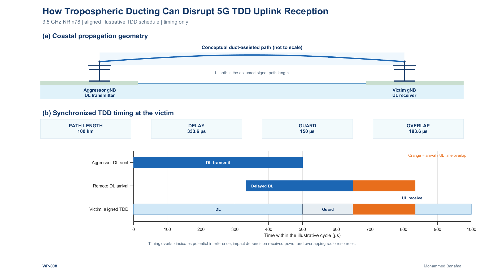
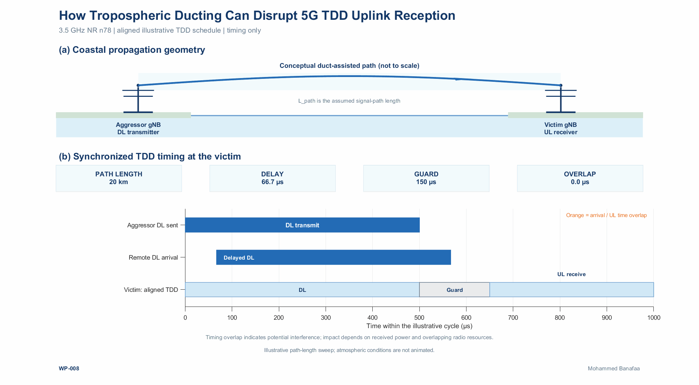

# WP-008 — How Tropospheric Ducting Can Disrupt 5G TDD Uplink Reception

**Series:** Wireless Propagation Visuals  
**Author:** Mohammed Banafaa  
**Application:** 3.5 GHz 5G NR TDD (band n78)  
**Software:** MATLAB R2024b

## Overview

In [WP-007](../WP-007/README.md), we examined how a surface-based atmospheric duct can change the receiver-height electromagnetic field relative to a standard atmosphere. WP-008 turns to a network-level consequence: **a remote downlink transmission may arrive during another synchronized base station's uplink reception interval**.

Atmospheric ducting can allow a distant base-station signal to remain receivable over an unusually long path. Because electromagnetic propagation takes time, the remote downlink can arrive *after* the receiving base station's downlink-to-uplink guard interval. This is the timing mechanism relevant to **remote interference management (RIM)** in 5G NR, addressed in 3GPP TS 38.300, §17.1.

**Central takeaway:** Synchronizing TDD transmit/receive schedules does not by itself prevent remote downlink-to-uplink interference when significant propagation delay is present. Temporal overlap indicates an opportunity for interference; actual impairment additionally depends on received signal power and overlapping radio resources.

This example is a **timing calculation and conceptual illustration**, not an electromagnetic duct simulation or a prediction of received interference power.

## Physical and network context

- **Aggressor gNB:** A distant base station transmitting downlink (DL).
- **Victim gNB:** A synchronized base station receiving uplink (UL).
- **Duct-assisted path:** A conceptual long-distance propagation path over a coastal/sea environment. Its geometry is not to scale and is not calculated by a PE solver.
- **Carrier frequency:** 3.5 GHz, within 5G NR band n78. Frequency establishes the system context; the simplified geometric delay depends on the assumed signal-path length and propagation speed, not directly on 3.5 GHz.
- **Synchronization:** Both base stations use the same illustrative DL/guard/UL schedule. The aggressor's radio signal is nevertheless received later because of path delay.

Atmospheric ducting does **not** slow electromagnetic waves. It can enable significant remote reception over paths for which delay becomes relevant to the TDD timing arrangement.

## Timing model

For an assumed one-way signal-path length \(L_{\mathrm{path}}\), propagation delay is approximated by

\[
\tau \approx \frac{L_{\mathrm{path}}}{c},
\qquad c=299\,792\,458\ \mathrm{m/s}.
\]

The assumed propagation-path length need not be identical to the horizontal distance between the gNBs. No additional atmospheric excess-delay calculation is attempted.

If the transmitted aggressor downlink occupies \([t_{D,0},t_{D,1})\), its delayed arrival occupies \([t_{D,0}+\tau,t_{D,1}+\tau)\). For the victim uplink reception interval \([t_{U,0},t_{U,1})\), the overlap duration is

\[
T_{\mathrm{overlap}}=
\max\!\left\{0,\ 
\min(t_{D,1}+\tau,t_{U,1})-
\max(t_{D,0}+\tau,t_{U,0})\right\}.
\]

The model evaluates *time intersection* between two intervals. It does not evaluate interference power, frequency-resource occupancy, signal-to-interference-plus-noise ratio (SINR), or network performance.

### Assumed synchronized TDD schedule

| Item | Illustrative value | Meaning |
|---|---:|---|
| TDD timeline | 0–1000 µs | One displayed cycle |
| Aggressor DL transmission | 0–500 µs | Transmitted at the same absolute timing reference as the victim schedule |
| Guard interval | 500–650 µs | **150 µs illustrative guard**, not a universal 3GPP NR requirement |
| Victim UL reception | 650–1000 µs | Receiving interval of interest |
| Application frequency | 3.5 GHz | 5G NR n78 TDD context |
| Path-length animation sweep | 20–140 km in 2 km steps | Separate hypothetical path lengths, not a moving antenna or changing duct |

### Reproducible numerical examples

| Assumed path length | One-way delay | Remote DL arrival | Overlap with victim UL |
|---:|---:|---|---:|
| **20 km** | **66.7 µs** | 66.7–566.7 µs | **0 µs** |
| **100 km** | **333.6 µs** | 333.6–833.6 µs | **183.6 µs** |

At 20 km, the remote downlink ends before the UL begins at 650 µs. At 100 km, its arrival extends into the UL interval from 650 to approximately 833.6 µs, giving **183.6 µs of timing overlap**.

The distances are chosen to demonstrate the timing mechanism; **they are not PE-predicted duct propagation distances or measurements**. In particular, the 150 µs guard and the displayed schedule are *assumptions* made for education, not a mandated NR TDD configuration.

## Figures and animation

### Static illustration



The PNG combines two views:

1. **Coastal propagation geometry:** Conceptual aggressor-to-victim duct-assisted path. The path shape is illustrative, not to scale.
2. **Synchronized TDD timeline:** Aggressor downlink transmission, delayed downlink arrival, and victim DL/guard/UL intervals. An **orange segment** identifies the temporal overlap when it occurs.

In the reviewed PNG, the readouts show the **20 km, no-overlap** example. The **100 km, 183.6 µs overlap** example is illustrated by a later animation state. For a static LinkedIn cover illustrating the interference mechanism itself, the 100 km state is preferable.

### Animated visualization



The intended GIF sweeps the **assumed path length** across separate scenarios while holding the TDD timeline, guard duration, and propagation speed fixed. Its readouts show **PATH LENGTH**, **DELAY**, **GUARD**, and **OVERLAP**. Orange highlights appear where the remote DL arrival overlaps the victim's UL reception.

**Animation interpretation:** The sweep changes an input parameter; it is **not** a time-domain animation of duct formation, temporal channel fading, the radio-wave travel process, or propagation speed.

**Release check:** Confirm that `Figures/WP008_Final.gif` is a genuine *multi-frame GIF*, not a single PNG image saved with a `.gif` extension. Review each readout and the highlighted overlap against the calculated intervals.

## MATLAB reproduction

The GitHub folder is intended to contain:

```text
WP-008/
├── WP008.m
├── README.md
└── Figures/
    ├── WP008_Final.png
    └── WP008_Final.gif
```

1. Download or clone the `WP-008` folder.
2. Open MATLAB R2024b, add or navigate to the folder containing `WP008.m`, and run `WP008`.
3. The script should create `Figures/` if needed and export the static illustration and animated GIF without private input files or interactive folder selection.
4. Verify the **20 km no-overlap** and **100 km 183.6 µs overlap** examples, the animation's 20–140 km assumed-path sweep, and the exported file formats.

The implementation is designed for base MATLAB. If you modify the illustrative schedule, check that transmitted and delayed arrival intervals remain consistent with the plotted cycle; the release script's interval consistency checks should prevent misleading cycle-wrap visualizations.

## Interpretation and limitations

- This is a **timing-only** demonstration, not a numerical PE propagation calculation.
- The 3.5 GHz carrier is representative of **5G NR n78**, but the assumed propagation delay is computed from path length and \(c\).
- A duct-assisted propagation path can facilitate significant distant reception; **duct existence, path length, and received interference power are not predicted here**.
- The guard interval, DL/UL timing, and path-length examples are **illustrative**, not a deployment recommendation or universally mandated 5G NR configuration.
- Temporal overlap alone does **not** establish harmful interference: the interferer must be strong enough at the victim and occupy relevant radio resources.
- No fading, noise, receiver sensitivity, antenna pattern, packet error rate, SINR, throughput, or outage analysis is performed.
- The GIF frames represent independent path-length scenarios, **not changing atmospheric conditions over time**.

## References

1. [3GPP TS 38.300 V17.3.0, §17.1 — Remote Interference Management](https://www.etsi.org/deliver/etsi_ts/138300_138399/138300/17.03.00_60/ts_138300v170300p.pdf).
2. [ITU-R Report M.2559-0 (2025) — *Mitigation of interference due to tropospheric ducting effect within an IMT network*](https://www.itu.int/pub/R-REP-M.2559).
3. [3GPP TS 38.104 V17.11.0 — NR base-station operating bands, including n78](https://www.etsi.org/deliver/etsi_ts/138100_138199/138104/17.11.00_60/ts_138104v171100p.pdf).

---

## LinkedIn post

**[𝐖𝐏-𝟎𝟎𝟖] 𝐇𝐨𝐰 𝐓𝐫𝐨𝐩𝐨𝐬𝐩𝐡𝐞𝐫𝐢𝐜 𝐃𝐮𝐜𝐭𝐢𝐧𝐠 𝐂𝐚𝐧 𝐃𝐢𝐬𝐫𝐮𝐩𝐭 𝟓𝐆 𝐓𝐃𝐃 𝐔𝐩𝐥𝐢𝐧𝐤 𝐑𝐞𝐜𝐞𝐩𝐭𝐢𝐨𝐧**

📡 In WP-007, we explored how atmospheric ducting changes long-range signal propagation at 3.5 GHz. But what happens when that distant signal arrives at the wrong time?

🌊 In synchronized **5G NR TDD (band n78)**, downlink and uplink transmissions are separated by a guard period. Under ducting conditions, signals from distant base stations can arrive after this protection interval.

📐 **The MATLAB timing results:** With an illustrative **150 µs guard period**, a 20 km path produces no overlap. At 100 km, the propagation delay reaches **333.6 µs**, causing **183.6 µs of remote downlink overlap** with the victim base station's uplink reception.

🧠 **The practical implication:** Even synchronized 5G TDD networks can experience remote downlink-to-uplink interference. Its severity depends on the received interfering power and overlapping radio resources.

🎥 **The accompanying MATLAB animation** demonstrates how increasing the assumed propagation-path length shifts the downlink arrival into the uplink interval.

↻ **Next up:** Can duct-aware path loss be estimated efficiently without full PE simulations?

#5GNR #RemoteInterference #TroposphericDucting #WirelessNetworks

**References:** 3GPP TS 38.300, Section 17.1; ITU-R Report M.2559-0 (2025); 3GPP TS 38.104.

*Simulation note: Illustrative TDD timing configuration, not measured interference or a standardized 150 µs guard-period requirement.*

---

**Mohammed Banafaa** · *Wireless Propagation Visuals* · **WP-008**
